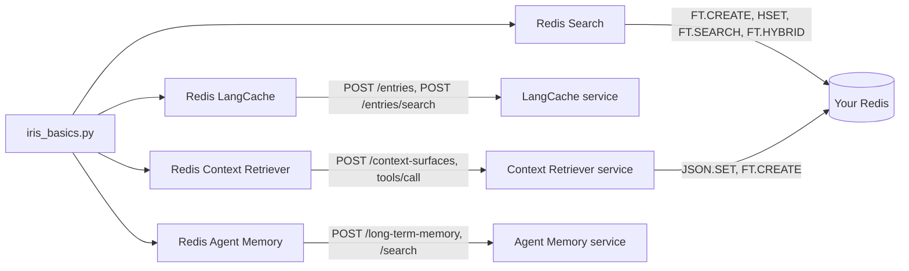

# How to take the Redis Iris services apart with one marimo notebook

> **TL;DR:** Redis Iris is the real-time context engine for agents: Redis Search underneath, then LangCache, Context Retriever, and Agent Memory as hosted services on Redis Cloud. This notebook takes the four apart, one column each, on Cairn Outfitters, a fictional outdoor-gear shop. In this tutorial, you will run a notebook that lets you index, cache, retrieve, and remember with the four Redis components behind an agent's context.

> **Note:** The code for this tutorial is the `redis-iris-basics` folder that holds this README: one notebook, one package, and one `.env`.

When your agent needs context, you need a search index, a semantic cache, governed access to your data, and a memory that outlives the session. Redis gives you all four in one data layer, and this notebook shows the exact command or request behind each.

LangCache and Agent Memory are in public preview, and Context Retriever is in preview.

## What you'll learn

- How one `FT.CREATE` over a key prefix answers a question by keyword (`BM25STD`), by meaning (a `VECTOR` field), and by both fused server-side (`FT.HYBRID`)
- How LangCache turns a `similarityThreshold` into a cache hit, a cache miss, or a wrong answer, and why `ttlMillis` is the safety net
- How Context Retriever turns three `ContextModel` classes into MCP tools, writes JSON documents into your own Redis, and refuses a call the schema does not allow
- How Agent Memory recalls a fact with no word in common with the question, and why `ownerId` and `namespace` travel on every request

## What you'll build

One marimo notebook, `iris_basics.py`, with four columns, one per component, and one `.env` that configures them. Each column connects read-only on load and writes only when you press a button whose label says what it writes. Each ends with a Clean up button that deletes only what that column wrote.

Each column has one job:

- Redis Search: answer a question over 36 help articles by keyword, by meaning, and by both
- Redis LangCache: return a stored answer for a question asked in other words
- Redis Context Retriever: turn three Python classes into MCP tools an agent calls over your Redis
- Redis Agent Memory: recall a customer fact with no word in common with the question

## Prerequisites

- [uv](https://docs.astral.sh/uv/)
- Python 3.12 or 3.13 (uv installs it)
- A Redis 8 database with Search and JSON, either local or Redis Cloud
- A LangCache service (API URL, cache ID, and API key)
- A Context Retriever admin key
- An Agent Memory service (endpoint, store ID, and API key)

> **Note:** The notebook does not start a local Redis instance. The only thing that runs on your machine is a 30 MB embedding model.

A column whose credentials you do not have says "not configured" and stops, so you can run any subset of the four.

## Step 1. Open the folder

```sh
cd redis-iris-basics
```

If you received the folder as a git repository, clone it first. `uv` reads `pyproject.toml` and
`uv.lock` on the first `uv run`, so there is nothing else to install by hand.

## Step 2. Configure the environment

Copy the sample file:

```sh
cp .env.example .env
```

Open `.env`, uncomment the variables for the columns you want to run, and fill them in. Every value comes from [Redis Cloud](https://cloud.redis.io) or from your own Redis.

| Variable | Default | Purpose |
|---|---|---|
| `REDIS_URL` | none | Redis Search and Context Retriever. `redis://default:<password>@<host>:<port>` from the database's Configuration page (Public endpoint) and Security page (Default user password). `rediss://` on a TLS database |
| `LANGCACHE_HOST` | none | LangCache. The URL on the service's Connectivity page |
| `LANGCACHE_CACHE_ID` | none | LangCache. The Cache ID on the same page |
| `LANGCACHE_API_KEY` | none | LangCache. The API key, shown once when the service is created |
| `CTX_ADMIN_KEY` | none | Context Retriever. An admin key from the Admin keys page, shown once |
| `CTX_API_URL` | `https://cloud.redis.io/context-surfaces` | Context Retriever. The admin API base. The default suits Redis Cloud |
| `CTX_MCP_URL` | `https://gcp-us-east4.context-surfaces.redis.io/mcp` | Context Retriever. The MCP address used only if the agent-key listing names none |
| `MEMORY_API_BASE_URL` | none | Agent Memory. The Endpoint on the service's General settings page, with `https://` |
| `MEMORY_STORE_ID` | none | Agent Memory. The Store ID on the same page |
| `MEMORY_API_KEY` | none | Agent Memory. A key from the service's API keys page, shown once |

Context Retriever uses the same `REDIS_URL` as Redis Search and hands that password to the hosted service, so point it at a scratch database.

## Step 3. Start the notebook

```sh
uv run marimo edit iris_basics.py
```

Or present it as an app:

```sh
uv run marimo run iris_basics.py
```

marimo loads `.env` when the kernel starts, and each configured column connects read-only: Redis answers `PONG`, and each hosted service answers `200`.

## Step 4. Search the help centre

In the Redis Search column, press **Load the help centre: 1 FT.CREATE, 36 HSET, 36 EXPIRE**.

Redis returns `OK` for the `FT.CREATE` and indexes each hash as it lands. `FT.INFO` reports `num_docs` 36 and `hash_indexing_failures` 0, and the cell prints the index, the first hash, and its expiry as Redis received them:

```
FT.CREATE idx:cairn:<run>:help ON HASH PREFIX 1 cairn:<run>:help: SCORE 1.0 SCHEMA title TEXT WEIGHT 2.0 body TEXT WEIGHT 1.0 category TAG SEPARATOR , year NUMERIC SORTABLE embedding VECTOR HNSW 6 TYPE FLOAT32 DIM 256 DISTANCE_METRIC COSINE
HSET cairn:<run>:help:ship-times title "How long does delivery take?" body "Standard orders leave our Denver warehouse within one busine...<127 chars>" category shipping year 2025 embedding <1024 bytes>
EXPIRE cairn:<run>:help:ship-times 3600
```

The cells below it run as soon as the load finishes:

1. `FT.SEARCH ... "hiking boots" SCORER BM25STD WITHSCORES` returns the match count and the top five rows with their scores. A title match counts double because `title` has weight 2.
2. Type a question under **Ask the help centre**. `KNN 3` returns three rows for any question, and `VECTOR_RANGE` with radius 0.5 returns only the articles within it. In a live run on 2026-10-01 the range returned 2 articles for the default question. Ask *best pizza near me*: it returned 0, which the cell marks as a miss.
3. The pre-filtered query `(@category:{returns|shipping} @year:[2024 2026])=>[KNN 5 ...]` returns five rows that all match the filter, below the same `KNN 5` over every article.
4. Choose a question under **Question**. The table shows the rank each engine gave every article, with the article that answers it starred. In a live run on 2026-10-01, `BM25STD` ranked nothing for *trail shoes feel cramped*, and the vector search and `FT.HYBRID` both ranked the boot guide first.

Every key expires after one hour. Step 8 removes them sooner.

## Step 5. Turn the similarity threshold

In the Redis LangCache column, press **Store 5 gear-care answers with ttlMillis 900000**. LangCache answers `201` with an `entryId` for each of the five prompts, and the table lists the five ids.

The next cell searches for *What's the right way to launder a goose-down sleeping bag?* at `similarityThreshold` 0.85. The stored prompt is *How do I wash my down sleeping bag?*:

```json
{"prompt": "What's the right way to launder a goose-down sleeping bag?", "similarityThreshold": 0.85, "searchStrategies": ["semantic"], "maxResults": 5}
```

LangCache answers `200` with the down-bag entry in `data`, its stored answer, and its `similarity`, 0.905 in a live run on 2026-10-01, although *launder* and *wash* share no word. In the same run LangCache scored *My rain jacket stopped beading water. How do I fix that?* at 0.812 against the rain-shell answer, under the line. Which questions clear the line is what the slider is for.

Drag the `similarityThreshold` slider. The table re-scores six labelled questions from one search each at 0.50. In a live run on 2026-10-01 at 0.85, two paraphrases were hits and the tent paraphrase missed at 0.839. The synthetic sleeping bag was a wrong answer at 0.950, and the negation missed at 0.735. Above 0.95 the red row goes too, and by then every paraphrase is already grey.

The strategies table sends two spellings of the stored down-bag prompt through `exact` and `semantic`. `exact` reports `similarity` 1 for the all-caps copy and misses the copy without its question mark. In a live run on 2026-10-01, `semantic` did the reverse.

Press **Run the cache-aside loop: miss, store for 10 s, hit, expire, 404**. The table shows five requests:

- `POST /entries/search` for the question: `200` with an empty `data`
- `POST /entries` with `ttlMillis` 10000: `201` with an `entryId`
- `POST /entries/search` for the question in other words: `200` with the taught entry, `similarity` 0.943 in a live run on 2026-10-01
- the same search after a 12-second wait: `200` with an empty `data`
- `DELETE /entries/{entryId}`: `404` with type `/errors/resource-not-found` in a live run on 2026-10-01

## Step 6. Generate tools from a data model

The Redis Context Retriever column declares three `ContextModel` classes, `Customer`, `Product`, and `Order`, and shows the `export_data_model` output before anything is sent. Press **Create the surface, an agent key, and load 20 records (sends your database password)**.

Context Retriever answers `201` with the surface id and a status, `provisioning_indices` in a live run on 2026-09-30, and the column reports `imported 6 + 6 + 8 records, 20 keys set to expire in 1 h`. The create request is shown as sent, with the password masked.

The next cell sends one JSON-RPC `tools/list` over MCP, and Context Retriever lists every tool it generated from the data model. In a live run on 2026-09-30 that was 21 tools. The cell after it calls `get_customer_by_id` with `{"id": "C001"}`, and Context Retriever returns the record for Ada Lovelace with a `_retrieval` stamp naming the surface that served it.

The column then sends two calls the schema should refuse. For `filter_customer` with no condition, Context Retriever answered `isError` with `at least one condition is required` in a live run on 2026-09-30. Its answer to a tag condition on the numeric field `lifetime_value` is printed as it arrives.

Last, the column reads your own database. `JSON.GET cairn:<run>:customer:C001` returns the document Context Retriever wrote, and `FT.INFO` on each index the service built reports `num_docs` 6, 8, and 6 for customer, order, and product.

## Step 7. Recall a memory by meaning

In the Redis Agent Memory column, press **Write 5 memories about Dana in one POST**.

Agent Memory answers `201` with `created` naming the five ids `cairn-<run>-m1` to `cairn-<run>-m5`. The cell shows the request as sent, with the credential masked:

```json
{"memories": [{"id": "cairn-<run>-m1", "text": "Dana is allergic to peanuts and tree nuts, so trail snacks and camp meals must not contain them.", "ownerId": "cairn-<run>", "namespace": "iris-basics-notebook", "memoryType": "semantic", "topics": ["food", "allergy"]}]}
```

Press the button again in the same kernel. Agent Memory answers `201` with the same five ids and no `errors`, as it did in a live run on 2026-10-01, so a second press makes no duplicate. Because the ids are yours, Clean up can name them without a ledger.

Leave the question at *What should the kitchen avoid serving me?* and the `similarityThreshold` slider at 0.3. In a live run on 2026-10-01 Agent Memory returned the allergy memory alone, ranked first with 0 content words in common. At 0.0 it returned all five in rank order, and at 0.5 the cell read `0 memories at or above 0.5`.

The reply carries no score. `similarityThreshold` is the only cut, and the request body under the table changes with the slider:

```json
{"text": "What should the kitchen avoid serving me?", "filter": {"ownerId": {"eq": "cairn-<run>"}, "namespace": {"eq": "iris-basics-notebook"}}, "filterOp": "all", "similarityThreshold": 0.3, "limit": 5}
```

The scope lens below it runs the same question at 0.0 under three filters: this owner in this namespace, an owner that does not exist, and a namespace that does not exist. In a live run on 2026-10-01 it returned 5, 0, and 0 memories. More than 5 in the first row means extraction has already added memories under this owner, which Clean up removes.

Press **Send 4 session events and assemble the prompt**. Agent Memory answers `201` for each event, and the session read-back shows `ownerId` `cairn-<run>` and `namespace` `iris-basics-notebook`, both taken from the first event. The cell prints the prompt an agent would receive for the last turn:

```
Retrieved memory context:
Session summary:
(none yet: this store summarises only when that is switched on and the session is long enough)
Short-term memory:
USER: I am training for a 50 kilometre trail race in April.
ASSISTANT: Noted: a 50 km race in April. Do steep descents give you any trouble?
USER: My left knee complains on steep downhills, so I always carry trekking poles.
Long-term memory:
- Dana is allergic to peanuts and tree nuts, so trail snacks and camp meals must not contain them.
- ...
```

Under it, the top memory read `#1 of 3 · 0 content words in common` in a live run on 2026-10-01.

## Step 8. Clean up

Press the Clean up button at the bottom of each column you used:

- Redis Search: `FT.DROPINDEX` without `DD`, then `UNLINK` on the 36 keys
- Redis LangCache: `DELETE /entries/{entryId}` for each of the 5 entries this kernel stored
- Redis Context Retriever: `DELETE` every surface named `cairn-<run>`, which also revokes its agent key. Then `UNLINK` on the 20 keys and `FT.DROPINDEX` without `DD` on the indexes the service left under the run prefix
- Redis Agent Memory: delete this owner's sessions, list its memories, check each `ownerId`, and delete them by id

If you sent session events, press Agent Memory's button again once the store's extraction cadence has passed. The default is 5 minutes, configurable from 60 to 600 seconds. Extraction adds memories with ids the service chooses, and this owner-scoped Clean up is what deletes them.

## How it works

Everything the notebook writes carries one run tag, derived from your user and host names. It reads the same in every kernel on one machine.

| Key | Type | Purpose |
|---|---|---|
| `cairn:<run>:help:<id>` | HASH | One help article: `title`, `body`, `category`, `year`, and a 1024-byte `embedding` |
| `idx:cairn:<run>:help` | Search index | Watches the `cairn:<run>:help:` prefix with `TEXT`, `TAG`, `NUMERIC`, and `VECTOR` fields |
| `cairn:<run>:customer:<id>`, `product:<sku>`, `order:<id>` | JSON | Written by the Context Retriever service into your database from the key templates you declared |
| `idx:<surface>:<hash>:<entity>` | Search index | Built by the Context Retriever service, one per entity, dropped with the surface |
| LangCache `entryId` | Cache entry | Chosen by the service, and the only handle on an entry, because a cache cannot be listed |
| `cairn-<run>-m<n>` | Long-term memory | Chosen by the notebook, so Clean up needs no ledger and a second write does not duplicate |
| `cairn-<run>-s<time>` | Session | One conversation, whose owner and namespace come from the first event |

The index that the Redis Search column creates, as Redis receives it:

```
FT.CREATE idx:cairn:<run>:help ON HASH PREFIX 1 cairn:<run>:help: SCORE 1.0 SCHEMA title TEXT WEIGHT 2.0 body TEXT WEIGHT 1.0 category TAG SEPARATOR , year NUMERIC SORTABLE embedding VECTOR HNSW 6 TYPE FLOAT32 DIM 256 DISTANCE_METRIC COSINE
```

A LangCache search, `POST /v1/caches/{cacheId}/entries/search`:

```json
{"prompt": "What's the right way to launder a goose-down sleeping bag?", "similarityThreshold": 0.85, "searchStrategies": ["semantic"], "maxResults": 5}
```

A Context Retriever surface, `POST /api/v1/context-surfaces`, with the password masked as the notebook shows it:

```json
{"name": "cairn-<run>", "description": "Made by the Redis Iris basics notebook. Safe to delete.", "metadata": {"created_by": "iris-basics-notebook", "run": "<run>"}, "data_model": {"title": "Cairn Outfitters", "description": "Customers, products, and orders of a fictional outdoor-gear shop", "entity_count": 3, "entities": ["..."]}, "data_source": {"type": "redis", "connection_config": {"addr": "<host>:<port>", "username": "default", "password": "***", "db": 0, "tls_enabled": false, "pool_size": 2, "min_idle_conns": 0}}}
```

One generated tool, called the way an agent calls it, as a JSON-RPC `tools/call` over MCP:

```json
{"jsonrpc": "2.0", "id": 2, "method": "tools/call", "params": {"name": "get_customer_by_id", "arguments": {"id": "C001"}}}
```

Five memories in one Agent Memory write, `POST /v1/stores/{storeId}/long-term-memory`:

```json
{"memories": [{"id": "cairn-<run>-m1", "text": "Dana is allergic to peanuts and tree nuts, so trail snacks and camp meals must not contain them.", "ownerId": "cairn-<run>", "namespace": "iris-basics-notebook", "memoryType": "semantic", "topics": ["food", "allergy"]}]}
```



| Column | Scope | Expires | Clean up | Never |
|---|---|---|---|---|
| Redis Search | Keys `cairn:<run>:help:*` and the index `idx:cairn:<run>:help` | Keys after one hour. The index does not | `FT.DROPINDEX` without `DD`, `UNLINK` on 36 keys | `FLUSHALL`, `DD`, a write outside the prefix |
| Redis LangCache | Entries by `entryId`, held in the kernel | Every entry after 15 minutes (`ttlMillis` 900000) | `DELETE /entries/{entryId}` per id | `/flush`, `DELETE /entries` with a body |
| Redis Context Retriever | Surface `cairn-<run>`, agent key `cairn-<run>-agent`, 20 keys under `cairn:<run>:` | Keys and the agent key after one hour. The surface does not | `DELETE` the surfaces named `cairn-<run>`, `UNLINK` on 20 keys, drop the indexes they left without `DD` | `DD`, another account's surface |
| Redis Agent Memory | Owner `cairn-<run>`, namespace `iris-basics-notebook`, memory ids `cairn-<run>-m1` to `m5` | Sessions after the store's session TTL, 1 hour by default. Long-term memories after a year by default | Delete this owner's sessions and memories after checking each `ownerId` | `includeAll`, an id whose owner differs |

A LangCache entry this kernel has forgotten is reached only by its 15-minute TTL. A Context Retriever surface has no TTL and keeps your database password until you delete it.

## Run the tests

```sh
uv run pytest
```

The suite runs offline with no credentials. It covers `marimo check --strict`, a run of the
notebook with no configuration, the safety and voice rules over the source, and the sample-data
package.

A live pass runs every cell in file order with every button pressed, and ends each column with
its Clean up:

```sh
uv run --env-file .env python tests/live_smoke.py
```

It prints one line per cell and never prints a configured value. Run it once against your own
services before you present, and read the result against the checklist in
`.agents/plans/iris-basics-mvp-plan.md`, section 18.

## Troubleshooting

### A column says "not configured"

Verify that `.env` sits next to `pyproject.toml` and that the column's variable names are uncommented, then restart the kernel.

### Context Retriever fails to define the model

You are running outside uv on Python 3.14. `ContextModel` reads class annotations in a way 3.14 defers. Use `uv run`, which picks 3.13.

### The three-engine table shows a note instead of a hybrid rank

Verify that the Redis version is 8.4 or later. `FT.HYBRID` does not exist before it, and the cell says so instead of running.

### The range query returns nothing for a sensible question

Raise the literal `0.5` radius in the `rs_knn_versus_range` cell. 0.5 is a starting point for this model, not a constant.

### Agent Memory answers 424

A dependency of the store failed, not zero results. Wait and retry.

### LangCache answers 401

Verify the key. A regenerated key invalidates the old one for every app that uses the service.

### Context Retriever tools answer 401

The agent key expires one hour after Create. Press Create again: it makes a second surface with the same name, and Clean up deletes both.

### A run_button cell went back to "press the button"

marimo reset it because a cell above re-ran. Press it again.

### Clean up cannot find the surface

Clean up lists every surface on the account and deletes each one named `cairn-<run>`, so an unfinished create cell is not the cause. Verify that `CTX_ADMIN_KEY` is still valid: when the listing answers anything but `200`, the cell says so and deletes only the id this kernel holds. The surface is named `cairn-<run>` in the console.

## FAQ

### Do I need Redis Cloud?

No. The Redis Search column runs on any Redis 8 with Search. The three hosted services, LangCache, Context Retriever, and Agent Memory, run on Redis Cloud.

### Does the notebook call an LLM?

No. The embedding model runs on your machine, and the hosted services embed on their side.

### What does the notebook leave behind if I close the laptop?

Redis keys and the agent key expire in an hour, and LangCache entries in 15 minutes. A Context Retriever surface never expires and Agent Memory long-term records last a year by default, so press Clean up. The run tag is the same every time you open the notebook on this machine. Clean up in a fresh kernel still finds the surface and the memories. LangCache is the exception: entries cannot be listed, so the 15-minute `ttlMillis` is the net.

### Can I point it at a shared Redis LangCache service?

Yes. Every entry the notebook stores carries a TTL, and the searches hide other apps' entries. A service of your own is better, because anything stored on a shared cache can be served to somebody else's app until it expires.

### Where do the numbers in the copy come from?

Live passes of this notebook on 2026-10-01 for Redis Search, LangCache, and Agent Memory, and one live run on 2026-09-30 for Context Retriever. Yours will differ by model, phrasing, and service version.

## Next steps

- Put a semantic cache in front of a real LLM call: [Semantic caching with Redis LangCache](https://redis.io/tutorials/semantic-caching-with-redis-langcache/)
- Give a LangGraph agent memory that outlives the session: [Redis Agent Memory with LangGraph](https://redis.io/tutorials/redis-agent-memory-with-langgraph/)
- Generate governed tools over your own data model: [Redis Context Retriever](https://redis.io/docs/latest/develop/ai/context-engine/context-retriever/)
- Tune a vector index for your own corpus: [Vector search practical guide](https://redis.io/blog/vector-search-practical-guide/)

## Additional resources

- [Redis Iris context engine](https://redis.io/docs/latest/develop/ai/context-engine/)
- [Redis Search and query](https://redis.io/docs/latest/develop/ai/search-and-query/)
- [Redis LangCache](https://redis.io/docs/latest/develop/ai/context-engine/langcache/) and its [API reference](https://redis.io/docs/latest/develop/ai/context-engine/langcache/api-reference/)
- [Redis Context Retriever](https://redis.io/docs/latest/develop/ai/context-engine/context-retriever/)
- [Redis Agent Memory](https://redis.io/docs/latest/develop/ai/context-engine/agent-memory/) and its [REST quickstart](https://redis.io/docs/latest/develop/ai/context-engine/agent-memory/rest-api-quickstart/)
- [redis-ai-resources](https://github.com/redis-developer/redis-ai-resources), the notebook collection

## Verified live

The Redis Search, LangCache, and Agent Memory facts come from two live passes of this notebook on 2026-10-01, on Redis Cloud (Redis 8.6.2). The Context Retriever facts come from one live run of an earlier notebook on 2026-09-30. Scores vary by model, phrasing, and service version.

2026-10-01, Redis Search:

- `FT.HYBRID ... LOAD 1 @__key` returned the RESP2 pair list the notebook parses. For *trail shoes feel cramped*, `BM25STD` ranked nothing, and the vector search and the hybrid both ranked *Finding your boot size* first.
- `VECTOR_RANGE` at radius 0.5 returned 2 articles for *will it fit my feet* and 0 for *best pizza near me*.
- Clean up dropped 1 index and unlinked 36 of 36 keys.

2026-10-01, LangCache:

- Every request answered the status the cell expected, including the planned `404`, so the custom `User-Agent` and the pinned `Content-Type` are accepted. Five stores took 0.38 s.
- LangCache scored the goose-down paraphrase at 0.905 against the down-bag entry. It scored the rain-jacket question at 0.812 against the rain-shell entry, under 0.85, and the same after 8 s, so it is not an indexing lag.
- Probe scores at 0.50: tent paraphrase 0.839, boots paraphrase 0.899, synthetic bag 0.950 against the down-bag entry, negation 0.735, and no own hit for the capital of Australia.
- *HOW DO I WASH MY DOWN SLEEPING BAG?* hit under `exact` and missed under `semantic`. The copy without its question mark did the reverse.
- Cache-aside: step 3 hit at 0.943, step 4 missed after 12 s, and step 5 answered `404` with type `/errors/resource-not-found`.
- Clean up: five bodiless `DELETE` requests with `Content-Type: application/json` answered `204`.

2026-10-01, Agent Memory:

- `GET /health` answered `200` `healthy`. The bulk write answered `201` with 5 ids in `created`, and a second write in the same kernel answered `201` with the same ids and no `errors`.
- For *What should the kitchen avoid serving me?* the allergy memory came back alone at 0.3 with 0 content words in common. All five came back at 0.0, and none at 0.5. The scope lens returned 5, 0, and 0.
- Four session events answered `201`, the read-back carried the first event's `ownerId` and `namespace`, and the top memory read `#1 of 3 · 0 content words in common`.
- Clean up deleted 1 session and 5 memories with 0 errors and 0 left. A third pass about 45 minutes after the first two sessions found no memory with a service-chosen id under the owner. Those sessions were deleted seconds after their events, so extraction from a session that stays alive is still unobserved.

2026-09-30, Context Retriever, from the earlier notebook:

- The surface listed 21 tools for three entities. `get_customer_by_id` with `{"id": "C001"}` returned the record plus a `_retrieval` stamp, and `filter_customer` with no condition answered `isError` with *at least one condition is required*.

The first live run of this notebook's Context Retriever column is pending: it needs `CTX_ADMIN_KEY` in `.env`. The schema-violation reply to the tag condition and the MCP session's explicit `Accept: */*` under niquests are recorded here after it.
