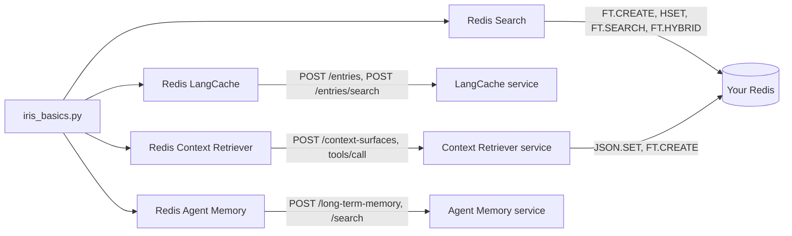

# How to take the Redis Iris services apart with one marimo notebook

> **TL;DR:** Redis Iris is the real-time context engine for agents: Redis Search underneath, with LangCache, Context Retriever, and Agent Memory as hosted services on Redis Cloud. In this tutorial, you will run a notebook that lets you index, cache, retrieve, and remember with the four Redis services behind an agent's context.

> **Note:** This tutorial uses the code from the following git repository: <repository URL>

When your agent needs context, you need a search index, a semantic cache, governed access to your data, and a memory that outlives the session. Redis gives you all four in one data layer, and this notebook shows the exact command or request behind each.

## What you'll learn

- How one `FT.CREATE` over a key prefix answers a question by keyword (`BM25STD`), by meaning (a `VECTOR` field), and by both fused server-side (`FT.HYBRID`)
- How LangCache turns a `similarityThreshold` into a cache hit, a cache miss, or a wrong answer, and why `ttlMillis` is the safety net
- How Context Retriever turns three `ContextModel` classes into MCP tools, writes JSON documents into your own Redis, and refuses a call the schema does not allow
- How Agent Memory recalls a fact with no word in common with the question, and why `ownerId` and `namespace` travel on every request

## What you'll build

One marimo notebook, `iris_basics.py`, with four columns, one per component, and one `.env` that configures them. Each column connects read-only on load and writes only when you press a button whose label says what it writes. Each ends with a Clean up button that deletes only what that column wrote.

## Prerequisites

- [uv](https://docs.astral.sh/uv/)
- Python 3.12 or 3.13 (uv installs it)
- A Redis 8 database with Search and JSON, either local or Redis Cloud
- A LangCache service (API URL, cache ID, and API key)
- A Context Retriever admin key
- An Agent Memory service (endpoint, store ID, and API key)

> **Note:** The notebook does not start a local Redis instance. The only thing that runs on your machine is a 30 MB embedding model.

A column whose credentials you do not have says "not configured" and stops, so you can run any subset of the four.

## Step 1. Clone the repository

```sh
git clone <repository URL> redis-iris-basics
cd redis-iris-basics
```

`uv` reads `pyproject.toml` and `uv.lock`, so there is nothing else to install by hand.

## Step 2. Configure the environment

Copy the sample file:

```sh
cp .env.example .env
```

Open `.env`, uncomment the variables for the columns you want to run, and fill them in. Every value comes from [Redis Cloud](https://cloud.redis.io) or from your own Redis.

| Variable | Default | Purpose |
|---|---|---|
| `REDIS_URL` | none | Redis Search and Context Retriever. `redis://default:<password>@<host>:<port>` from the database's Configuration page (public endpoint) and Security page (default user password). `rediss://` on a TLS database |
| `LANGCACHE_HOST` | none | LangCache. The URL on the service's Connectivity page |
| `LANGCACHE_CACHE_ID` | none | LangCache. The Cache ID on the same page |
| `LANGCACHE_API_KEY` | none | LangCache. The API key, shown once when the service is created |
| `CTX_ADMIN_KEY` | none | Context Retriever. An admin key from the Admin keys page, shown once |
| `CTX_API_URL` | `https://cloud.redis.io/context-surfaces` | Context Retriever. The admin API base, which the default suits on Redis Cloud |
| `CTX_MCP_URL` | `https://gcp-us-east4.context-surfaces.redis.io/mcp` | Context Retriever. The MCP address used only if the agent-key listing names none |
| `MEMORY_API_BASE_URL` | none | Agent Memory. The Endpoint on the service's General settings page, with `https://` |
| `MEMORY_STORE_ID` | none | Agent Memory. The Store ID on the same page |
| `MEMORY_API_KEY` | none | Agent Memory. A key from the service's API keys page, shown once |

Context Retriever uses the same `REDIS_URL` as Redis Search and hands that password to the hosted service, so point it at a scratch database.

## Step 3. Start the notebook

```sh
uv run marimo edit iris_basics.py
```

Or present it as an app:

```sh
uv run marimo run iris_basics.py
```

marimo loads `.env` when the kernel starts, and each configured column connects read-only: Redis answers `PONG`, and each hosted service answers `200`.

<!-- column 0 -->

<!-- column 1 -->

<!-- column 2 -->

<!-- column 3 -->

## Step 8. Clean up

Press the Clean up button at the bottom of each column you used:

- Redis Search: `FT.DROPINDEX` without `DD`, then `UNLINK` on the 36 keys
- LangCache: `DELETE /entries/{entryId}` for each of the 5 entries this kernel stored
- Context Retriever: `DELETE` every surface named `cairn-<run>`, which also revokes its agent key, then `UNLINK` on the 20 keys and `FT.DROPINDEX` without `DD` on the indexes the service left under the run prefix
- Agent Memory: delete this owner's sessions, list its memories, check each `ownerId`, and delete them by id

If you sent session events, press Agent Memory's button again once the store's extraction cadence has passed, 5 minutes by default and configurable from 60 to 600 seconds. Extraction adds memories with ids the service chooses, and this owner-scoped Clean up is what deletes them.

## How it works

Everything the notebook writes carries one run tag, derived from your user and host names, so it reads the same in every kernel on one machine.

| Key | Type | Purpose |
|---|---|---|
| `cairn:<run>:help:<id>` | HASH | One help article: `title`, `body`, `category`, `year`, and a 1024-byte `embedding` |
| `idx:cairn:<run>:help` | Search index | Watches the `cairn:<run>:help:` prefix with `TEXT`, `TAG`, `NUMERIC`, and `VECTOR` fields |
| `cairn:<run>:customer:<id>`, `product:<sku>`, `order:<id>` | JSON | Written by the Context Retriever service into your database from the key templates you declared |
| `idx:<surface>:<hash>:<entity>` | Search index | Built by the Context Retriever service, one per entity, dropped with the surface |
| LangCache `entryId` | Cache entry | Chosen by the service, and the only handle on an entry, because a cache cannot be listed |
| `cairn-<run>-m<n>` | Long-term memory | Chosen by the notebook, so a second write is an update and Clean up needs no ledger |
| `cairn-<run>-s<time>` | Session | One conversation, whose owner and namespace come from the first event |

The index that column 0 creates, as Redis receives it:

```
FT.CREATE idx:cairn:<run>:help ON HASH PREFIX 1 cairn:<run>:help: SCORE 1.0 SCHEMA title TEXT WEIGHT 2.0 body TEXT WEIGHT 1.0 category TAG SEPARATOR , year NUMERIC SORTABLE embedding VECTOR HNSW 6 TYPE FLOAT32 DIM 256 DISTANCE_METRIC COSINE
```

A LangCache search, `POST /v1/caches/{cacheId}/entries/search`:

```json
{"prompt": "My rain jacket stopped beading water. How do I fix that?", "similarityThreshold": 0.85, "searchStrategies": ["semantic"], "maxResults": 5}
```

A Context Retriever surface, `POST /api/v1/context-surfaces`, with the password masked as the notebook shows it:

```json
{"name": "cairn-<run>", "description": "Made by the Redis Iris basics notebook. Safe to delete.", "metadata": {"created_by": "iris-basics-notebook", "run": "<run>"}, "data_model": {"title": "Cairn Outfitters", "entity_count": 3, "entities": ["..."]}, "data_source": {"type": "redis", "connection_config": {"addr": "<host>:<port>", "username": "default", "password": "***", "db": 0, "tls_enabled": false, "pool_size": 2, "min_idle_conns": 0}}}
```

One generated tool, called the way an agent calls it, as a JSON-RPC `tools/call` over MCP:

```json
{"jsonrpc": "2.0", "id": 2, "method": "tools/call", "params": {"name": "get_customer_by_id", "arguments": {"id": "C001"}}}
```

Five memories in one Agent Memory write, `POST /v1/stores/{storeId}/long-term-memory`:

```json
{"memories": [{"id": "cairn-<run>-m1", "text": "Dana is allergic to peanuts and tree nuts, so trail snacks and camp meals must not contain them.", "ownerId": "cairn-<run>", "namespace": "iris-basics-notebook", "memoryType": "semantic", "topics": ["food", "allergy"]}]}
```



| Column | Scope | Expires | Clean up | Never |
|---|---|---|---|---|
| Redis Search | Keys `cairn:<run>:help:*` and the index `idx:cairn:<run>:help` | Keys after one hour. The index does not | `FT.DROPINDEX` without `DD`, `UNLINK` on 36 keys | `FLUSHALL`, `DD`, a write outside the prefix |
| LangCache | Entries by `entryId`, held in the kernel | Every entry after 15 minutes (`ttlMillis` 900000) | `DELETE /entries/{entryId}` per id | `/flush`, `DELETE /entries` with a body |
| Context Retriever | Surface `cairn-<run>`, agent key `cairn-<run>-agent`, 20 keys under `cairn:<run>:` | Keys and the agent key after one hour. The surface does not | `DELETE` the surfaces named `cairn-<run>`, `UNLINK` on 20 keys, drop the indexes they left without `DD` | `DD`, another account's surface |
| Agent Memory | Owner `cairn-<run>`, namespace `iris-basics-notebook`, memory ids `cairn-<run>-m1` to `m5` | Nothing. Memories last a year | Delete this owner's sessions and memories after checking each `ownerId` | `includeAll`, an id whose owner differs |

A LangCache entry this kernel has forgotten is reached only by its 15-minute TTL. A Context Retriever surface has no TTL and keeps your database password until you delete it.

## Troubleshooting

### A column says "not configured"

Verify that `.env` sits next to `pyproject.toml` and that the column's variable names are uncommented, then restart the kernel.

### Context Retriever fails to define the model

Verify that `uv run python --version` reports 3.13 or older. `ContextModel` reads class annotations in a way Python 3.14 defers.

### The hybrid column shows a note

Verify that the Redis version is 8.4 or later. `FT.HYBRID` does not exist before it, and the cell says so instead of running.

### The range query returns nothing for a sensible question

Raise the literal `0.5` radius in the `rs_knn_versus_range` cell. 0.5 is a starting point for this model, not a constant.

### Agent Memory answers 424

A dependency of the store failed, not zero results. Wait and retry, or check the service's status in the console.

### LangCache answers 401

Verify the key. A regenerated key invalidates the old one for every app that uses the service.

### A run_button cell went back to "press the button"

marimo reset it because a cell above re-ran. Press it again.

### Clean up cannot find the surface

The create cell did not finish. The surface, if it was created, is named `cairn-<run>` in the console and can be deleted there.

## FAQ

### Do I need Redis Cloud?

No. Column 0 runs on any Redis 8 with Search. The three hosted services, LangCache, Context Retriever, and Agent Memory, run on Redis Cloud.

### Does the notebook call an LLM?

No. The embedding model runs on your machine, and the hosted services embed on their side.

### What does the notebook leave behind if I close the laptop?

Redis keys and the agent key expire in an hour, and LangCache entries in 15 minutes. A Context Retriever surface and Agent Memory records do not expire, so press Clean up. The run tag is the same every time you open the notebook on this machine, so Clean up in a fresh kernel still finds the surface and the memories. LangCache is the exception: entries cannot be listed, so the 15-minute `ttlMillis` is the net.

### Can I point it at a shared LangCache?

Yes. Every entry the notebook stores carries a TTL, and the searches hide other apps' entries. A service of your own is better, because anything stored on a shared cache can be served to somebody else's app until it expires.

### Where do the numbers in the copy come from?

One live run on 2026-09-30. Yours will differ by model, phrasing, and service version.

## Next steps

- Put a semantic cache in front of a real LLM call: [Semantic caching with Redis LangCache](https://redis.io/tutorials/semantic-caching-with-redis-langcache/)
- Give a LangGraph agent memory that outlives the session: [Redis Agent Memory with LangGraph](https://redis.io/tutorials/redis-agent-memory-with-langgraph/)
- Generate governed tools over your own data model: [Redis Context Retriever](https://redis.io/docs/latest/develop/ai/context-engine/context-retriever/)
- Tune a vector index for your own corpus: [Vector search practical guide](https://redis.io/blog/vector-search-practical-guide/)

## Additional resources

- [Redis Iris context engine](https://redis.io/docs/latest/develop/ai/context-engine/)
- [Redis Search and query](https://redis.io/docs/latest/develop/ai/search-and-query/)
- [Redis LangCache](https://redis.io/docs/latest/develop/ai/context-engine/langcache/) and its [API reference](https://redis.io/docs/latest/develop/ai/context-engine/langcache/api-reference/)
- [Redis Context Retriever](https://redis.io/docs/latest/develop/ai/context-engine/context-retriever/)
- [Redis Agent Memory](https://redis.io/docs/latest/develop/ai/context-engine/agent-memory/) and its [REST quickstart](https://redis.io/docs/latest/develop/ai/context-engine/agent-memory/rest-api-quickstart/)
- [redis-ai-resources](https://github.com/redis-developer/redis-ai-resources), the notebook collection

## Verified live

The facts the copy relies on come from one live run on 2026-09-30 against a Redis Cloud database on Redis 8.6.2 and the three hosted services. Scores vary by model, phrasing, and service version.

- Redis Search: `FT.HYBRID ... LOAD 1 @__key` returned the RESP2 pair-list reply the notebook parses. For *trail shoes feel cramped*, `BM25STD` returned no row, while KNN and hybrid ranked the boot guide first.
- LangCache: the rain-shell paraphrase scored 0.896. The worst wrong answer in the threshold table scored 0.950. An entry stored with `ttlMillis` expired within about a second of the value, and a `DELETE` on the expired entry answered `404` with type `/errors/resource-not-found`.
- Context Retriever: the account served the unified tool surface, 21 tools for three entities. `get_customer_by_id` with `{"id": "C001"}` returned the record plus a `_retrieval` stamp, and `filter_customer` with no condition answered `isError` with *at least one condition is required*.
- Agent Memory: the search reply carried no score. The allergy memory came back first for *What should the kitchen avoid serving me?* with 0 words in common.

The schema-violation reply, the cache-aside hit score, and the `Accept`-less MCP session under niquests are recorded here after the first live run of this notebook.
