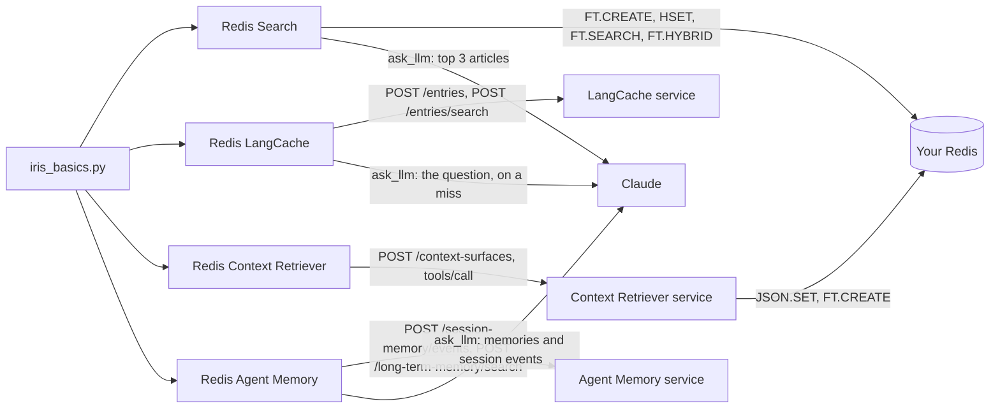

# How to take the Redis Iris services apart with one marimo notebook

> **TL;DR:** Redis Iris is the real-time context engine for agents: Redis Search underneath, then LangCache, Context Retriever, and Agent Memory as hosted services on Redis Cloud. This notebook takes the four apart, one column each, on Cairn Outfitters, a fictional outdoor-gear shop. In this tutorial, you will run a notebook that lets you index, cache, retrieve, and remember with the four Redis components behind an agent's context.

> **Note:** The code for this tutorial is the `redis-iris-basics` folder that holds this README: one notebook, one package, and one `.env`.

When your agent needs context, you need a search index, a semantic cache, governed access to your data, and a memory that outlives the session. Redis gives you all four in one data layer, and this notebook shows the exact command or request behind each.

LangCache and Agent Memory are in public preview, and Context Retriever is in preview.

## What you'll learn

- Redis Search
  - An index follows every write under its prefix
  - Redis fuses keyword and vector rankings in one command
  - Filters run inside the vector search
- Redis LangCache
  - Your app searches before the LLM and stores after it
  - The threshold trades wrong answers for misses
  - A cached answer lives until its time to live (TTL) runs out
- Redis Context Retriever
  - The data model generates the tools
  - The agent can call only what the model defines
  - Context Retriever is a layer on top of your Redis
- Redis Agent Memory
  - Long-term memory recalls facts by meaning
  - The owner and namespace are the tenant boundary
  - An agent turn reads both tiers

## What you'll build

One marimo notebook, `iris_basics.py`, with five columns, and one `.env` that configures them. Column 0 holds the setup and one client per service, Claude included. Each of the other four columns holds one component.

A component column has a seed button, a chat or a tool console, a last-turn panel, and a Clean up button. The Search, LangCache, and Agent Memory chats call the model named by `AI_MODEL` in column 0, `gpt-4o-mini` at first. Context Retriever gets a tool console with no LLM.

Nothing is written until you press a seed button, submit the Search form, or send a chat message. A LangCache miss stores the model's answer, and each Agent Memory message writes two session events: the message and the agent's reply. Each Clean up button deletes what its column wrote.

Each column has one job:

- Redis Search: answer a question over 36 help articles by keyword, by meaning, and by both
- Redis LangCache: return a stored answer for a question asked in other words
- Redis Context Retriever: turn three Python classes into MCP tools an agent calls over your Redis
- Redis Agent Memory: recall a customer fact with no word in common with the question

## Prerequisites

- [uv](https://docs.astral.sh/uv/)
- Python 3.12 or 3.13 (uv installs it)
- A Redis 8.4 or later database with Search and JSON, either local or Redis Cloud
- A LangCache service (API URL, cache ID, and API key)
- A Context Retriever admin key
- An Agent Memory service (endpoint, store ID, and API key)
- An LLM API key for the three chats: an OpenAI key when `AI_MODEL` starts with `gpt`, an Anthropic key when it starts with `claude`

> **Note:** The notebook does not start a local Redis instance. The only thing that runs on your machine is a 30 MB embedding model.

Each service's client cell reads only that service's variables. A missing variable raises `KeyError` in that cell, and every cell in its column shows marimo's *An ancestor raised an exception* notice. The other columns still run. Without an LLM key the client still builds, and each chat turn reports the failed model call in the chat.

## Step 1. Open the folder

```sh
cd redis-iris-basics
```

If you received the folder as a git repository, clone it first. `uv` reads `pyproject.toml` and
`uv.lock` on the first `uv run`, so there is nothing else to install by hand.

## Step 2. Configure the environment

Copy the sample file:

```sh
cp .env.example .env
```

Open `.env`, uncomment the variables for the columns you want to run, and fill them in. Every value comes from [Redis Cloud](https://cloud.redis.io) or from your own Redis.

| Variable | Default | Purpose |
|---|---|---|
| `REDIS_URL` | none | Redis Search and Context Retriever. `redis://default:<password>@<host>:<port>` from the database's Configuration page (Public endpoint) and Security page (Default user password). `rediss://` on a TLS database |
| `LANGCACHE_HOST` | none | LangCache. The URL on the service's Connectivity page |
| `LANGCACHE_CACHE_ID` | none | LangCache. The Cache ID on the same page |
| `LANGCACHE_API_KEY` | none | LangCache. The API key, shown once when the service is created |
| `CTX_ADMIN_KEY` | none | Context Retriever. An admin key from the Admin keys page, shown once |
| `CTX_API_URL` | `https://cloud.redis.io/context-surfaces` | Context Retriever. The admin API base. The default suits Redis Cloud |
| `MEMORY_API_BASE_URL` | none | Agent Memory. The Endpoint on the service's General settings page, with `https://` |
| `MEMORY_STORE_ID` | none | Agent Memory. The Store ID on the same page |
| `MEMORY_API_KEY` | none | Agent Memory. A key from the service's API keys page, shown once |
| `LLM_API_KEY` | none | The Search, LangCache, and Agent Memory chats. An OpenAI key when `AI_MODEL` starts with `gpt`, or an Anthropic key when it starts with `claude` |

Context Retriever uses the same `REDIS_URL` as Redis Search and hands that password to the hosted service, so point it at a scratch database.

## Step 3. Start the notebook

```sh
uv run marimo edit iris_basics.py
```

Or present it as an app:

```sh
uv run marimo run iris_basics.py
```

marimo loads `.env` when the kernel starts. Column 0 loads the embedding model and builds one client per service. It sends nothing to Redis, the hosted services, or the LLM.

Until you press a column's seed button, the cells that need its data show marimo's *Ancestor stopped* notice.

## Step 4. Search the help center

In the Redis Search column, press **Load the help center: 1 FT.CREATE, 36 HSET, 36 EXPIRE**.

Redis answers `OK` to the `FT.CREATE`, and the cell shows that reply. The cell writes the 36 hashes in three pipelines of 12 and runs `FT.INFO` after each one. In a live run on 2026-10-05, `num_docs` read 12, 24, and 36, with 0 indexing failures:

```
FT.CREATE idx:cairn:<run>:help ON HASH PREFIX 1 cairn:<run>:help: SCORE 1.0 SCHEMA title TEXT WEIGHT 2.0 body TEXT WEIGHT 1.0 category TAG SEPARATOR , year NUMERIC SORTABLE embedding VECTOR HNSW 6 TYPE FLOAT32 DIM 256 DISTANCE_METRIC COSINE
HSET cairn:<run>:help:ship-times title "How long does delivery take?" body "Standard orders leave our Denver warehouse within one busine...<127 chars>" category shipping year 2025 embedding <1024 bytes>
EXPIRE cairn:<run>:help:ship-times 3600
FT.INFO idx:cairn:<run>:help
```

Each hash expires after one hour, and the index has no TTL. A second press before Clean up rewrites keys the index holds, so its first row shows the full count.

After the load, the chat appears. Set the filters above it, then type a question or pick a suggested prompt:

- **Categories (none means all)**: a multiselect of the six categories, all selected at first
- **Year floor**: a slider from 2022 to 2026, at 2022 at first
- Suggested prompts: *trail shoes feel cramped*, *Trailhead*, *waterproofng*, *Where is my parcel?*, and the December gift question below

Each question runs `FT.HYBRID` with the filter inside both the keyword and the vector side:

```
FT.HYBRID idx:cairn:<run>:help SEARCH "<words> (@category:{...} @year:[<floor> 2026])" SCORER BM25STD VSIM @embedding $vector KNN 2 K 10 FILTER "(@category:{...} @year:[<floor> 2026])" COMBINE RRF 4 WINDOW 20 CONSTANT 60 LOAD 1 @__key LIMIT 0 10 PARAMS 2 vector <1024 bytes>
```

The cell also runs `BM25STD` and `KNN 10` under the same filter, and `KNN 5` with and without it. Claude gets the top three articles and the question, and the reply lists the titles it received.

The last-turn panel under the chat ranks each article Claude received under `BM25STD`, KNN, and `FT.HYBRID`. In a live run on 2026-10-05, with Claude stubbed, the top article ranked as follows:

| Question | `FT.HYBRID` first | `BM25STD` | KNN | `FT.HYBRID` |
|---|---|---|---|---|
| *trail shoes feel cramped* | Finding your boot size | - | 1 | 1 |
| *Trailhead* | Resoling worn boots | 1 | 3 | 1 |
| *waterproofng* | Restoring waterproofing on shells and boots | - | 1 | 1 |
| *Where is my parcel?* | Shipping outside the US | - | 1 | 1 |

`-` means outside the top ten. `FT.HYBRID` answered in 45 to 66 ms.

The panel also compares the unfiltered top five, filtered in the app, with `KNN 5` with the filter inside. Move **Year floor** to 2025 and ask *Where is my parcel?* again. In the 2026-10-05 run the app kept 3, and `KNN 5` with the filter inside returned 5.

Below the panel, a sweep runs `KNN 5` for *where is my parcel* at each year floor, with the categories you chose. With only `returns` and `shipping` selected, the 2026-10-05 run read:

| Year floor | Articles that pass | Top 5, then filter in the app | Filter inside `KNN 5` |
|---|---|---|---|
| 2022 | 13 | 5 | 5 |
| 2023 | 12 | 5 | 5 |
| 2024 | 10 | 4 | 5 |
| 2025 | 8 | 3 | 5 |
| 2026 | 4 | 1 | 4 |

Those counts include the form's article. With the filter in front of `=>`, Redis returned fewer than five only when fewer passed.

The form at the bottom writes one more article. Its fields are **Title**, **Body**, **Category**, and **Year**, prefilled with a holiday gift-returns article. Press **Add the article: 1 HSET, 1 EXPIRE**.

The cell writes `cairn:<run>:help:reader` with a one-hour `EXPIRE` and reads `num_docs` before and after. In the 2026-10-05 run it went from 36 to 37, and a second submit read 37 to 37.

Ask *Can I return a gift I got in December?* before and after the submit. In that run the new article was absent from the top three before it, and ranked first by KNN and `FT.HYBRID` after it.

## Step 5. Cache an answer by meaning

In the Redis LangCache column, press **Store 5 answers for 15 minutes: 5 POST /entries, 16 searches**.

The cell asks *How do I wash my down sleeping bag?* before this press stores anything. It then stores five gear-care answers with `ttlMillis` 900000 and asks the question again in other words:

```json
{"prompt": "What's the right way to launder a goose-down sleeping bag?", "similarityThreshold": 0.85, "searchStrategies": ["semantic"], "maxResults": 5}
```

In a live run on 2026-10-05 the table read:

| step | request | status | result |
|---|---|---|---|
| 1 ask | `POST /entries/search` | 200 | miss |
| 2 store 5 answers | `POST /entries x5` | 201 201 201 201 201 | 5 entryIds |
| 3 ask in other words | `POST /entries/search` | 200 | hit: bag at 0.905 |

A miss is `200` with an empty `data`. Step 3 hit at 0.905, although *launder* and *wash* share no word.

LangCache derives each `entryId` from the prompt text, so a later press reuses the same five ids. In a scratch check on 2026-10-05, a second store of one prompt answered `201` with the same id. It also replaced the response and the TTL.

After the seed press, the Cairn support chat appears. Set its three controls, then type a question or pick a suggested prompt:

- `similarityThreshold`: a slider from 0.50 to 1.00, at 0.85 at first
- `searchStrategies`: `semantic` or `exact`
- **`ttlMillis` for an answer stored on a miss**: 10 s, 1 minute, or 15 minutes, at 1 minute at first
- Suggested prompts:
  - the seven labeled questions in the table below
  - *At Cairn Outfitters: How do I fix a snapped tent pole?*
  - *At Cairn Outfitters: What should I do about a broken tent pole?*, its rewording

Each question searches LangCache at your controls. A hit returns the stored answer with its similarity and milliseconds. A miss sends the question alone to Claude and stores Claude's answer with the `ttlMillis` you picked.

The last-turn panel shows the decision, the cache milliseconds, and Claude's milliseconds on a miss. A second `semantic` search at 0.50 lists the closest entries and marks which clear your threshold. A history table lists every turn, with each chat answer's age and `ttlMillis`.

In a live run on 2026-10-05, with Claude stubbed, the chat measured:

| Question | Controls | Decision | Similarity |
|---|---|---|---|
| What's the right way to launder a goose-down sleeping bag? | `semantic`, 0.85 | hit: bag | 0.905 |
| How do I wash my synthetic sleeping bag? | `semantic`, 0.85 | wrong answer: bag | 0.950 |
| How do I wash my synthetic sleeping bag? | `semantic`, 0.96, 10 s | miss, Claude's answer stored | - |
| the same question, at once | `semantic`, 0.96 | hit on the chat's answer, age 0.2 s | 1.000 |
| the same question, about 12 seconds later | `semantic`, 0.96 | miss, stored again | - |
| HOW DO I WASH MY DOWN SLEEPING BAG? | `exact`, 0.85 | hit: bag | 1 |
| What's the right way to launder a goose-down sleeping bag? | `exact`, 0.85 | miss | - |
| the snapped tent pole, then the broken one | `semantic`, 0.85, 1 minute | miss, then a hit on the chat's answer | 0.943 |

Each decision search took 64 to 111 ms. For the synthetic bag, the closest entries at 0.50 were bag 0.950, shell 0.716, stove 0.707, boots 0.699, and tent 0.680.

The table under the panel scores the seven labeled questions against the five seeded answers. It shows the `similarityThreshold` slider a second time, and moving it re-cuts the scores with no new request:

| question | kind | similarity |
|---|---|---|
| What's the right way to launder a goose-down sleeping bag? | paraphrase | 0.905 |
| how should i put my tent away after a trip | paraphrase | 0.839 |
| Best way to get the mud off my Trailhead boots? | paraphrase | 0.899 |
| HOW DO I WASH MY DOWN SLEEPING BAG? | same words, capitals | - |
| How do I wash my synthetic sleeping bag? | swapped item | 0.950 |
| How do I avoid washing my down sleeping bag? | negation | 0.735 |
| What is the capital of Australia? | unrelated | - |

In the 2026-10-05 run, `semantic` read 2 hits and 1 wrong answer at 0.85, and 0 and 0 at 0.96. `exact` read 1 hit and 0 wrong answers. The synthetic bag scored above every paraphrase, so no similarity threshold in that run kept a hit and removed that wrong answer.

A new service's default TTL is no expiration, so an answer stored without `ttlMillis` is served until your app deletes it.

## Step 6. Generate tools from a data model

> **Note:** This column has not run live in its current form. Every result this step quotes comes from a run of an earlier notebook on 2026-09-30.

The Redis Context Retriever column declares three `ContextModel` classes, `Customer`, `Product`, and `Order`. Its first cell sends nothing. It shows which tools each field's `index` kind generates, and the `export_data_model` output for the 3 entities.

Press **Create the surface: 6 admin requests, with your database password**. The cell sends six admin requests:

1. `POST /context-surfaces` with the data model and your database password
2. `POST .../agent-keys` for an agent key that expires in one hour
3. `GET .../agent-keys` for the surface's MCP address
4. `POST .../data` three times, once per entity

The callout shows the status Context Retriever answered, the surface id and status, and when the agent key expires. Under it are the import counts per entity and the create request as sent, with the credential and password masked. The service sets no TTL on what it writes, so the notebook sends a one-hour `EXPIRE` to each of the 20 keys. It shows how many answered `1`.

The next cell sends one JSON-RPC `tools/list` over MCP with the agent key. Its table lists every tool the service generated, with required arguments starred. On 2026-09-30 the surface listed 21 tools. Order has no `text` field, so there was no `search_order_by_text`.

The console under it sends one read-only `tools/call` per submit. Pick an entry in **Tool or preset**, a searchable dropdown that starts on `get_customer_by_id`. It lists every tool from `tools/list`, plus three presets that step outside the model:

- **filter_customer, no condition**: `{"limit": 5, "offset": 0}`
- **filter_customer, a tag condition on a numeric field**: `{"tag_conditions": [{"field": "lifetime_value", "value": "4200"}]}`
- **run_query, a raw query no generated tool takes**: `{"query": "KEYS *"}`

The form below the dropdown prefills **Tool** and **Arguments, as JSON** from your pick, for example `{"id": "C001"}`. Edit either field, then press **Send tools/call (read-only)**.

The last-call panel adds one row per call, newest first. Each row shows the tool, whether it is `in tools/list`, the arguments, the HTTP status, and the answer kind. The kind is `data`, `tool error`, or a JSON-RPC error with its code. Under the table are the full reply text and the request as sent.

On 2026-09-30, `get_customer_by_id` with `{"id": "C001"}` returned the record for Ada Lovelace with a `_retrieval` stamp naming the surface. The no-condition call came back as a tool error, *at least one condition is required*. No other console call has run live.

The last cell reads your own database. `JSON.GET cairn:<run>:customer:C001` returns the document Context Retriever wrote. `FT._LIST` and `FT.INFO` show each index the service built, with its document count and prefix.

## Step 7. Recall a memory by meaning

In the Redis Agent Memory column, press **Write 5 memories about Dana: 1 POST /long-term-memory**.

Agent Memory answers `201`, and the cell reports how many of the 5 ids sent are in `created`. The ids are `cairn-<run>-m1` to `cairn-<run>-m5`. The cell shows the five memories and the request as sent, with the credential masked:

```json
{"memories": [{"id": "cairn-<run>-m1", "text": "Dana is allergic to peanuts and tree nuts, so trail snacks and camp meals must not contain them.", "ownerId": "cairn-<run>", "namespace": "iris-basics-notebook", "memoryType": "semantic", "topics": ["food", "allergy"]}]}
```

In a check on 2026-10-05, a second identical write answered `201` with the same five ids, and the owner still held 5 memories. Because the ids are yours, Clean up can name them without a ledger.

The chat under the seed is the Cairn agent, and you are Dana. Set its two controls, then type a message or pick a suggested prompt:

- **Recall scope**: **Dana: this notebook's owner and namespace**, **Another customer: a different ownerId**, or **Another app: a different namespace**
- `similarityThreshold`: a slider from 0.0 to 1.0, at 0.0 at first
- Suggested prompts:
  - *What should the kitchen avoid serving me?*
  - *My toes feel squashed on long descents.*
  - *Somewhere freezing to visit next year?*
  - *I am training for a 50 kilometre trail race in April.*
  - *My left knee complains on steep downhills, so I always carry trekking poles.*

Each message makes four Agent Memory requests and one Claude call:

1. `POST /session-memory/events` with your message
2. `POST /long-term-memory/search` with your message, the scope's filter, your threshold, and `limit` 3
3. `GET /session-memory/{sessionId}` for the events in order
4. One Claude call with the recalled memories as the system prompt and the session events as messages
5. `POST /session-memory/events` with Claude's reply

The first message, or the first after you clear the chat, starts a new session. The last-turn panel shows the session's events, the recalled memories with rank and content words in common, and the filter as sent. It ends with the exact text Claude received.

In a live run on 2026-10-05, with Claude stubbed, the first turn under **Dana** at 0.0 sent Claude this:

```
You are the Cairn Outfitters support agent. Answer the customer in two or three sentences.
Long-term memory recalled for this customer:
- Dana is allergic to peanuts and tree nuts, so trail snacks and camp meals must not contain them.
- Dana wants parcels sent express, with no plastic packaging.
- Dana prefers gear made from recycled materials and will pay extra for it.

user: What should the kitchen avoid serving me?
```

The allergy memory ranked first with 0 content words in common. In the same run *I am training for a 50 kilometre trail race in April.* recalled the Patagonia trek first. The session read back `USER`, `ASSISTANT`, `USER`.

Under **Another customer** and **Another app**, the search recalled 0 memories, so Claude's system prompt carried none of Dana's. The API key was the same throughout.

The table under the panel asks the three suggested questions at your scope and threshold, with `limit` 100. In the 2026-10-05 run it read:

| Scope and threshold | kitchen | toes | freezing |
|---|---|---|---|
| Dana, 0.0 | #1 of 5 | #1 of 5 | #1 of 5 |
| Dana, 0.3 | #1 of 1 | not in the 0 returned | #1 of 1 |
| Dana, 0.5 | not in the 0 returned | not in the 0 returned | not in the 0 returned |
| Another customer or Another app, 0.0 | not in the 0 returned | not in the 0 returned | not in the 0 returned |

The reply ranks memories best first and carries no score. In the 2026-10-05 run, each item held `createdAt`, `id`, `memoryType`, `namespace`, `ownerId`, `text`, `topics`, and `updatedAt`.

## Step 8. Clean up

Press the Clean up button at the bottom of each column you used:

- Redis Search: **Clean up: FT.DROPINDEX and UNLINK by name** drops the index without `DD`, then unlinks the 36 keys and the form's article. On 2026-10-05 it read *Dropped 1 index. Unlinked 37 of 37 keys.*
- Redis LangCache: **Clean up: DELETE the 5 answers and the chat's answers by id** sends one `DELETE /entries/{entryId}` per id. A `204` is a deletion, and a `404` means the TTL or an earlier Clean up removed the entry. On 2026-10-05 it read *Deleted 8, already gone 0.*
- Redis Context Retriever: **Clean up: DELETE the surface and UNLINK 20 keys** deletes every surface named `cairn-<run>` and revokes their agent keys. It then counts what the delete left in your Redis and unlinks the 20 keys.
- Redis Agent Memory: **Clean up: DELETE this owner's sessions and memories** deletes this owner's sessions, chat sessions included, then the memories whose `ownerId` matches. On 2026-10-05 it deleted 2 of 2 sessions and 5 memories, 0 of them extracted from sessions.

After chatting with the Cairn agent, press Agent Memory's button again ten minutes later. Extraction runs every 5 minutes by default, configurable from 60 to 600 seconds, and adds memories with ids the service chooses. This owner-scoped Clean up is what deletes them.

## How it works

Column 0 holds what the four component columns share. The setup block runs first and defines:

- `RUN_TAG`, `KEY_PREFIX` (`cairn:<run>:`), and `KEY_TTL_SECONDS` (3600)
- `iris_session(base_url, headers)`, which builds an HTTP session for one hosted service
- `call_service(service, method, path, ...)`, which sends one request and returns `(status, body, wire)`

Then each client gets its own cell:

| Cell | Defines | Reads |
|---|---|---|
| `redis_client` | `REDIS_CLIENT`, a redis-py client with `protocol=2`, `decode_responses=True`, and a 30-second health check | `REDIS_URL` |
| `embedding_model` | `EMBEDDING_MODEL`, potion-base-8M, which embeds on your machine | nothing |
| `llm_client` | `stream_llm`, which streams from OpenAI or Anthropic according to `AI_MODEL` | `LLM_API_KEY` |
| `langcache_client` | `LANGCACHE` | `LANGCACHE_HOST`, `LANGCACHE_CACHE_ID`, and `LANGCACHE_API_KEY` |
| `context_retriever_client` | `CONTEXT_RETRIEVER`, with a 60-second read timeout | `CTX_ADMIN_KEY` and `CTX_API_URL` |
| `agent_memory_client` | `AGENT_MEMORY`, `MEMORY_OWNER_ID` (`cairn-<run>`), and `MEMORY_NAMESPACE` (`iris-basics-notebook`) | `MEMORY_API_BASE_URL`, `MEMORY_STORE_ID`, and `MEMORY_API_KEY` |
| `langcache_search_helper` | `langcache_search`, one search that hides every entry this press did not store | nothing |

A client cell with a missing variable fails alone, and marimo skips only the cells that read its names.

`iris_session` returns a niquests session that sends and accepts JSON, sends `User-Agent: redis-iris-basics`, and turns HTTP/3 off. It pins `Content-Type`, because niquests would otherwise append `;charset=utf-8`. It never retries, so a replayed create cannot make a second surface holding your password.

`call_service` returns the wire: the request as sent, with `Authorization` and `X-API-Key` masked, plus the status and milliseconds. A status outside `ok=` raises a `RuntimeError` naming the method, path, status, problem type, and title:

```
RuntimeError: POST /entries/search answered 401 <problem type> <problem title>
```

The message never carries the problem's `detail`, because a detail can echo the request, and one request carries a database password. The default `ok=` is `(200, 201, 204)`. Each delete that tolerates a missing record adds `404` to `ok=`, and the MCP tool calls pass `ok=(200, 400)`.

`ask_llm(system, messages)` makes one Claude call and returns the reply text. Each chat turn calls it at most once:

```python
LLM.beta.messages.create(
    model="claude-opus-5-5", max_tokens=16000, system=system, messages=messages,
    output_config={"effort": "low"},
    betas=["server-side-fallback-2026-07-01"], fallbacks="default",
)
```

The call runs at low effort to keep a chat turn quick. With the server-side fallback, Anthropic re-runs a declined request on the model it recommends for that refusal category. A refusal that survives the fallback raises `RuntimeError: Claude declined this request (<category>).`, so no chat stores it as an answer.

Each chat cell defines its controls, its `mo.ui.chat`, and a list that gets one record per turn. The chat's model function reads each control's `.value` when a message arrives. marimo never re-runs the cell that defines an element when that element changes, so moving a control keeps the chat history.

A last-turn cell reads the chat and the turn list, so it re-runs after every reply. The Context Retriever console follows the same idea across three cells: the dropdown, the prefilled form, and the call table.

Everything the notebook writes to Redis, Context Retriever, and Agent Memory carries one run tag, derived from your user and host names. It reads the same in every kernel on one machine. LangCache entries carry no tag.

| Key | Type | Purpose |
|---|---|---|
| `cairn:<run>:help:<id>` | HASH | One help article: `title`, `body`, `category`, `year`, and a 1024-byte `embedding` |
| `cairn:<run>:help:reader` | HASH | The article the Search form writes. Each submit replaces it |
| `idx:cairn:<run>:help` | Search index | Watches the `cairn:<run>:help:` prefix with `TEXT`, `TAG`, `NUMERIC`, and `VECTOR` fields |
| `cairn:<run>:customer:<id>`, `product:<sku>`, `order:<id>` | JSON | Written by the Context Retriever service into your database from the key templates you declared |
| `idx:<surface>:<hash>:<entity>` | Search index | Built by the Context Retriever service, one per entity. Clean up counts any left after the delete |
| LangCache `entryId` | Cache entry | Derived by the service from the prompt text, and the only handle on an entry, because a cache cannot be listed |
| `cairn-<run>-m<n>` | Long-term memory | Chosen by the notebook, so Clean up needs no ledger and a second write does not duplicate |
| `cairn-<run>-s<time>` | Session | One chat conversation, whose owner and namespace come from the first event |

The index that the Redis Search column creates, as Redis receives it:

```
FT.CREATE idx:cairn:<run>:help ON HASH PREFIX 1 cairn:<run>:help: SCORE 1.0 SCHEMA title TEXT WEIGHT 2.0 body TEXT WEIGHT 1.0 category TAG SEPARATOR , year NUMERIC SORTABLE embedding VECTOR HNSW 6 TYPE FLOAT32 DIM 256 DISTANCE_METRIC COSINE
```

A LangCache search, `POST /v1/caches/{cacheId}/entries/search`:

```json
{"prompt": "What's the right way to launder a goose-down sleeping bag?", "similarityThreshold": 0.85, "searchStrategies": ["semantic"], "maxResults": 5}
```

A Context Retriever surface, `POST /api/v1/context-surfaces`, with the credential and password masked as the notebook shows it:

```json
{"name": "cairn-<run>", "description": "Made by the Redis Iris basics notebook. Safe to delete.", "metadata": {"created_by": "iris-basics-notebook", "run": "<run>"}, "data_model": {"title": "Cairn Outfitters", "description": "Customers, products, and orders of a fictional outdoor-gear shop", "entity_count": 3, "entities": ["..."]}, "data_source": {"type": "redis", "connection_config": {"addr": "<host>:<port>", "username": "default", "password": "***", "db": 0, "tls_enabled": false, "pool_size": 2, "min_idle_conns": 0}}}
```

One generated tool, called the way an agent calls it, as a JSON-RPC `tools/call` over MCP:

```json
{"jsonrpc": "2.0", "id": 2, "method": "tools/call", "params": {"name": "get_customer_by_id", "arguments": {"id": "C001"}}}
```

Five memories in one Agent Memory write, `POST /v1/stores/{storeId}/long-term-memory`:

```json
{"memories": [{"id": "cairn-<run>-m1", "text": "Dana is allergic to peanuts and tree nuts, so trail snacks and camp meals must not contain them.", "ownerId": "cairn-<run>", "namespace": "iris-basics-notebook", "memoryType": "semantic", "topics": ["food", "allergy"]}]}
```



| Column | Scope | Expires | Clean up | Never |
|---|---|---|---|---|
| Redis Search | Keys `cairn:<run>:help:*` and the index `idx:cairn:<run>:help` | Keys after one hour. The index does not | `FT.DROPINDEX` without `DD`, `UNLINK` on the 36 keys and the form's article | `FLUSHALL`, `DD`, a write outside the prefix |
| Redis LangCache | Entries by `entryId`, for the five seeded answers and the chat's answers, held in the kernel | The seeded answers after 15 minutes. A chat answer after the `ttlMillis` you picked, 15 minutes at most | `DELETE /entries/{entryId}` per id | `/flush`, `DELETE /entries` with a body |
| Redis Context Retriever | Surface `cairn-<run>`, agent key `cairn-<run>-agent`, 20 keys under `cairn:<run>:` | Keys and the agent key after one hour. The surface does not | `DELETE` the surfaces named `cairn-<run>`, count what they left, `UNLINK` on 20 keys | `DD`, another account's surface |
| Redis Agent Memory | Owner `cairn-<run>`, namespace `iris-basics-notebook`, memory ids `cairn-<run>-m1` to `m5`, and every chat session | No TTL per record. By default the store expires sessions after 1 hour and long-term memories after 365 days | Delete this owner's sessions, then the memories whose `ownerId` matches | `includeAll`, an id whose owner differs |

A LangCache entry this kernel has forgotten is reached only by its TTL, 15 minutes at most. A Context Retriever surface has no TTL and keeps your database password until you delete it.

## Run the tests

```sh
uv run pytest
```

The command runs the suite in `tests/`.

A live pass runs every cell in file order with every button pressed, and ends each column with
its Clean up:

```sh
uv run --env-file .env python tests/live_smoke.py
```

It prints one line per cell and never prints a configured value. It sends no chat message, so it makes no Claude call.
Run it once against your own services before you present.

## Troubleshooting

### A client cell raises KeyError

Verify that `.env` sits next to `pyproject.toml` and that the service's variables are uncommented, then restart the kernel. Until then, every cell in that column shows *An ancestor raised an exception*.

### A chat turn raises an authentication error

Verify that `LLM_API_KEY` is set and valid in `.env` and matches the provider of `AI_MODEL`, then restart the kernel. With an invalid key, each chat turn ends with "The model call failed" and the error's name.

The Redis and service requests before the Claude call have already run. LangCache stores nothing for that turn. Agent Memory keeps your message as a session event, and Claude receives it on later turns.

### A chat turn raises "Claude declined this request"

Claude refused, and the server-side fallback model refused too. The error names the refusal category, and nothing is stored. Rephrase the message and send it again.

### A cell raises RuntimeError

A request answered a status outside the cell's `ok=`. The message names the status, problem type, and title, and the entries below cover the common ones.

### Context Retriever fails to define the model

You are running outside uv on Python 3.14. `ContextModel` reads class annotations in a way 3.14 defers. Use `uv run`, which picks 3.13.

### Agent Memory raises a RuntimeError naming 424

A dependency of the store failed, not zero results. Wait and retry.

### LangCache raises a RuntimeError naming 401

Verify the key. A regenerated key invalidates the old one for every app that uses the service.

### The Context Retriever console raises a RuntimeError naming 401

The agent key expires one hour after Create. Press Clean up, then Create.

### The Context Retriever console raises JSONDecodeError

Verify that **Arguments, as JSON** holds valid JSON. The traceback names the position, and nothing was sent.

### The LangCache chat history went blank

A seed press re-runs the chat cell, which clears the history and the turn list. The notebook still tracks the chat's stored answers, so Clean up deletes them.

### A cell shows marimo's Ancestor stopped notice

Verify that you pressed the column's seed button in this kernel. marimo also resets a button when a cell above it re-runs, so press it again.

### Clean up cannot find the surface

Clean up lists every surface on the account, page by page, and deletes each one named `cairn-<run>`. Verify that `CTX_ADMIN_KEY` is still valid. If the listing fails, the cell raises a `RuntimeError` before it deletes anything. The surface is named `cairn-<run>` in the console.

## FAQ

### Do I need Redis Cloud?

No. The Redis Search column runs on any Redis 8.4 or later with Search. The three hosted services, LangCache, Context Retriever, and Agent Memory, run on Redis Cloud.

### Does the notebook call an LLM?

Yes. The Search, LangCache, and Agent Memory chats call Claude (`claude-opus-5-5`) through `ask_llm`, at most once per turn:

- Redis Search sends the top three articles as the system prompt, plus your question alone
- Redis LangCache sends only your question, and only on a miss, so a stored answer fits anyone who asks it
- Redis Agent Memory sends the recalled memories as the system prompt, plus the session's events in order

The Context Retriever console calls no LLM. The embedding model runs on your machine, and the hosted services embed on their side.

### What does the notebook leave behind if I close the laptop?

Redis keys and the agent key expire in an hour, and LangCache entries in 15 minutes at most. A Context Retriever surface never expires and Agent Memory long-term records last a year by default, so press Clean up. The run tag is the same every time you open the notebook on this machine. Clean up in a fresh kernel still finds the surface and the memories. LangCache is the exception: entries carry no tag and cannot be listed, so `ttlMillis` is the net. LangCache's Clean up needs a seed press in this kernel.

### Can I point it at a shared Redis LangCache service?

Yes. Every entry the notebook stores carries a TTL, and the searches hide other apps' entries. LangCache derives each id from the prompt text, so two people running this notebook on one cache share the five ids. Either person's seed press overwrites the other's, and either Clean up deletes both. A service of your own is better, because anything stored on a shared cache can be served to somebody else's app until it expires.

### Where do the numbers in the copy come from?

The Redis Search, LangCache, and Agent Memory numbers come from live runs of this notebook on 2026-10-05, with Claude replaced by a stub. The Context Retriever numbers come from an earlier notebook's run on 2026-09-30. Yours will differ by model, phrasing, and service version.

## Next steps

- Put a semantic cache in front of a real LLM call: [Semantic caching with Redis LangCache](https://redis.io/tutorials/semantic-caching-with-redis-langcache/)
- Give a LangGraph agent memory that outlives the session: [Redis Agent Memory with LangGraph](https://redis.io/tutorials/redis-agent-memory-with-langgraph/)
- Generate governed tools over your own data model: [Redis Context Retriever](https://redis.io/docs/latest/develop/ai/context-engine/context-retriever/)
- Tune a vector index for your own corpus: [Vector search practical guide](https://redis.io/blog/vector-search-practical-guide/)

## Additional resources

- [Redis Iris context engine](https://redis.io/docs/latest/develop/ai/context-engine/)
- [Redis Search and query](https://redis.io/docs/latest/develop/ai/search-and-query/)
- [Redis LangCache](https://redis.io/docs/latest/develop/ai/context-engine/langcache/) and its [API reference](https://redis.io/docs/latest/develop/ai/context-engine/langcache/api-reference/)
- [Redis Context Retriever](https://redis.io/docs/latest/develop/ai/context-engine/context-retriever/)
- [Redis Agent Memory](https://redis.io/docs/latest/develop/ai/context-engine/agent-memory/) and its [REST quickstart](https://redis.io/docs/latest/develop/ai/context-engine/agent-memory/rest-api-quickstart/)
- [redis-ai-resources](https://github.com/redis-developer/redis-ai-resources), the notebook collection

## Verified live

No real Claude call has run yet. No Claude credential was on the test machine, so every chat turn below ran with `ask_llm` replaced by a stub. Claude's replies, latency, refusals, and authentication errors are unverified, and every Claude time came from the stub.

The Redis Search, LangCache, and Agent Memory facts come from live runs of this notebook on 2026-10-05, on Redis Cloud. A harness called each chat's model function directly and moved the controls the way a reader would. No chat ran in a browser. That moving a control keeps the chat history comes from the marimo 0.25.0 source.

Context Retriever was not run live in its new form, because no `CTX_ADMIN_KEY` was available. Scores vary by model, phrasing, and service version.

2026-10-05, Redis Search, three live runs:

- The load answered `OK`, and `FT.INFO` read `num_docs` 12, 24, and 36, with 0 indexing failures.
- A second load after a form submit answered `SEARCH_INDEX_EXISTS Index already exists`, and every row read 37.
- `FT.HYBRID` with `FILTER` ran live for the first time and answered in 45 to 66 ms. The RESP2 reply parsed as written.
- The `BM25STD`, KNN, and `FT.HYBRID` ranks of the top article were -, 1, and 1 for *trail shoes feel cramped*. They were 1, 3, and 1 for *Trailhead*, and -, 1, and 1 for *waterproofng*.
- At year floor 2025, *Where is my parcel?* kept 3 articles filtered in the app and 5 with the filter inside `KNN 5`.
- The form took `num_docs` from 36 to 37, and a second submit read 37 to 37. The new article then ranked first for the December question.
- With `returns` and `shipping` selected, the filter inside `KNN 5` returned 5, 5, 5, 5, and 4 for the year floors 2022 to 2026.
- A stub that raised on one turn left the next turn working, with Claude given only the current question.
- Clean up dropped 1 index and unlinked 37 of 37 keys. A second press read *The index was already gone. Unlinked 0 of 37 keys.*

2026-10-05, LangCache, four live runs and two scratch checks:

- The seed missed on step 1, stored five answers with `201`, and hit the down-bag entry at 0.905.
- The chat hit the goose-down paraphrase at 0.905 and served the down-bag answer for the synthetic bag at 0.950.
- At 0.96 with a 10 s TTL, the synthetic bag missed and was stored. It hit at once, then missed about 12 seconds later and was stored again.
- Under `exact`, the all-caps copy hit at 1 and the goose-down paraphrase missed.
- The tent-pole rewording hit the chat's stored answer at 0.943.
- Every chat store answered `201`, and each `entryId` matched the MD5 of its prompt.
- The threshold table read 2 hits and 1 wrong answer at 0.85, and 0 and 0 at 0.96, with no request sent.
- A seed press cleared the chat and kept all 3 chat answers tracked for Clean up.
- A stub that raised left one row reading `miss, no answer stored`, and the same question then stored normally.
- Clean up deleted 8 entries with `204`. A second press read *Deleted 0, already gone 8.*
- One scratch check stored one prompt twice. Both stores answered `201` with the same `entryId`, and the second replaced the response and TTL.
- The other scratch check isolated the all-caps prompt. It returned no entry under `semantic` at 0.50 and hit at 1 under `exact`.

2026-10-05, Agent Memory, three live runs and one repeat-write check:

- The bulk write answered `201` with 5 ids in `created`. In the check, two identical writes returned the same ids, and the owner held 5.
- Every session event answered `201`, every search `200`, and every read-back `200`. The session carried `ownerId` `cairn-<run>` and `namespace` `iris-basics-notebook`.
- The kitchen question recalled the allergy memory first of 3, with 0 content words in common.
- The other two scopes recalled 0 memories, and Claude's system prompt carried no memory lines.
- The recall table read #1 of 5 for all three questions at 0.0, and none at 0.5.
- A stub that raised on the first turn left its customer event in the session, and the next message reused that session.
- Clean up deleted 2 of 2 sessions and 5 memories, 0 of them extracted. Each run deleted its sessions within seconds, so extraction is still unobserved.

2026-10-05, Context Retriever, offline only:

- The data-model cell ran with no credentials. `export_data_model` gave 3 entities, and all 20 record keys sit under `cairn:<run>:`.
- A rehearsal with fake replies ran every request path, the password mask, and seven console submits. It proves the code paths, not the service.
- Never verified live:
  - Any call through `iris_session` and `call_service` under niquests
  - Every console call except `get_customer_by_id` and the no-condition preset
  - The prefilled examples for the `list_`, `count_`, `summarize_`, `search_`, and set tools
  - The statuses the import and `DELETE` return, and the index count after `DELETE`

2026-09-30, Context Retriever, from the earlier notebook:

- The surface listed 21 tools for three entities. `get_customer_by_id` with `{"id": "C001"}` returned the record plus a `_retrieval` stamp, and `filter_customer` with no condition answered `isError` with *at least one condition is required*.

The first live run of this notebook's Context Retriever column needs `CTX_ADMIN_KEY` in `.env`. The first real chat turns need `LLM_API_KEY`.
